<div align="center">

<!-- ======================= MIDNIGHT TOKYO CITY BANNER ======================= -->
<!-- Option 1 (Default): Animated Vector Midnight Tokyo Skyline (Zero load time, infinite resolution) -->
<a href="https://thepc101.github.io" target="_blank">
  
</a>

<!-- Option 2: Cinematic Anime Midnight Tokyo Wallpaper (To use this instead, uncomment below): -->
<!-- <a href="https://thepc101.github.io" target="_blank"></a> -->

<br/><br/>

<!-- ======================= DYNAMIC TYPING BANNER ======================= -->
<a href="https://thepc101.github.io" target="_blank">
  
</a>

<br/><br/>

<!-- ======================= CONNECT BUTTONS WITH ICONS ======================= -->
<p align="center">
  <a href="https://thepc101.github.io" target="_blank">
    
  </a>
  &nbsp;
  <a href="mailto:medisummarize@gmail.com">
    
  </a>
  &nbsp;
  <a href="https://github.com/thepc101">
    
  </a>
</p>

</div>

---

<!-- ======================= FOUNDER TERMINAL ======================= -->
### ⚡ Executive Profile

```bash
pranav@tokyo-midnight-box:~$ neofetch --profile
```

```yaml
identity:
  name: Pranav (プラナフ)
  role: Student Founder, Applied AI & Robotics Engineer
  vibe: "Midnight Tokyo Lab • Deep work, hardware hacking & shipping impactful AI"
  mission: "Building software and hardware that replaces friction with real human utility."
  primary_focus: [Healthcare, Education, Robotics & Embedded, Emotional Wellbeing, Internal Tooling]

current_status:
  shipping: "6+ production AI products, native tools, and embedded robotics prototypes"
  open_for: "Client consulting, AI automation, bespoke tools & robotics collaborations"
  core_philosophy: "Made with intent, not templates."
```

---

### 🚀 Flagship Ventures & Products

<table width="100%">
  <thead>
    <tr align="left">
      <th width="24%">Product</th>
      <th width="18%">Domain</th>
      <th width="42%">What It Does</th>
      <th width="16%">Status</th>
    </tr>
  </thead>
  <tbody>
    <tr>
      <td><b>🏛️ Publick</b></td>
      <td><code>EdTech • AI</code></td>
      <td>AI college counselor guiding high schoolers through college admissions step-by-step.</td>
      <td><a href="https://publick.app"></a></td>
    </tr>
    <tr>
      <td><b>🌿 Aurelia</b></td>
      <td><code>Mental Health</code></td>
      <td>AI-driven mood & emotion tracker helping users unpack why they feel the way they feel.</td>
      <td><a href="https://aureliamood.vercel.app"></a></td>
    </tr>
    <tr>
      <td><b>🩺 Medisummarize</b></td>
      <td><code>HealthTech</code></td>
      <td>Pre-appointment patient preparation assistant to eliminate clinical visit friction.</td>
      <td><a href="https://medisummarize-alpha.vercel.app"></a></td>
    </tr>
    <tr>
      <td><b>⚡ Grauque</b></td>
      <td><code>AI Client • Mac</code></td>
      <td>Free BYOK LLM with multimodal vision, KaTeX math, active study modes & native popup AI.</td>
      <td><a href="https://grauque.vercel.app"></a></td>
    </tr>
    <tr>
      <td><b>📖 Futurely</b></td>
      <td><code>EdTech</code></td>
      <td>Next-gen assignment & exam preparation platform for smart, targeted studying.</td>
      <td><a href="https://futurely.lovable.app"></a></td>
    </tr>
    <tr>
      <td><b>🤝 StudyCluster</b></td>
      <td><code>Social Learning</code></td>
      <td>Real-time peer study & collaboration space — because no student should study alone.</td>
      <td><a href="https://studycluster.lovable.app"></a></td>
    </tr>
    <tr>
      <td><b>🐞 Probe</b></td>
      <td><code>DevTools</code></td>
      <td>Intelligent automated bug triage and debugging workflow engine.</td>
      <td></td>
    </tr>
  </tbody>
</table>

<br/>

<details>
<summary><b>🛠️ Bespoke Client Solutions & Internal Systems</b> <i>(Click to expand)</i></summary>

<br/>

I design and build end-to-end bespoke software for businesses and teams looking to automate their manual bottlenecks:
- 🔄 **Workflow & AI Automations**: Autonomous data ingestion, summaries, and agent pipelines.
- 🏢 **Operations & Team Hubs**: Single-pane-of-glass dashboards for internal tracking and tasks.
- 📊 **Custom Metric & Work Trackers**: Bespoke internal tools tailored to specific team KPIs.

</details>

---

### 🧰 Technical Arsenal & Ecosystem

<div align="center">

<!-- Interactive Skill Icons Grid (22 Icons Perfectly Centered) -->
<a href="https://skillicons.dev">
  
</a>

<br/><br/>

</div>

#### 💻 Core Programming Languages
<p align="left">
  
  
  
  
  
  
  
  
</p>

#### 🤖 Robotics, Hardware & Embedded Systems
<p align="left">
  
  
  
  
  
  
  
</p>

#### 🌐 Frontend & Web Engineering
<p align="left">
  
  
  
  
  
</p>

#### 🧠 Backend, AI & Cloud Infrastructure
<p align="left">
  
  
  
  
  
  
  
</p>

---

### 📊 Live GitHub Telemetry & Activity

<div align="center">

<!-- Dual Metrics: Profile Statistics & Live Streak Tracker -->
<table border="0" style="border: none;">
  <tr style="border: none;">
    <td align="center" style="border: none;">
      <a href="https://github.com/thepc101">
        
      </a>
    </td>
    <td align="center" style="border: none;">
      <a href="https://github.com/thepc101">
        
      </a>
    </td>
  </tr>
</table>

<br/>

<!-- Top Languages Card -->
<p align="center">
  
</p>

<!-- Live 30-Day Contribution Activity Curve Graph -->
<p align="center">
  
</p>

</div>

---

<div align="center">

### *"Made with intent, not templates."*

<p align="center">
  <a href="https://thepc101.github.io">Portfolio</a> &nbsp;•&nbsp; 
  <a href="mailto:medisummarize@gmail.com">Contact</a> &nbsp;•&nbsp; 
  <a href="https://github.com/thepc101">GitHub</a>
</p>

<sub>© Pranav • 東京 // 深夜開発室 (Tokyo Midnight Lab)</sub>

</div>
